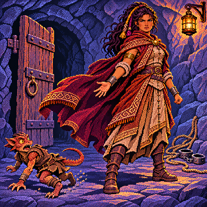
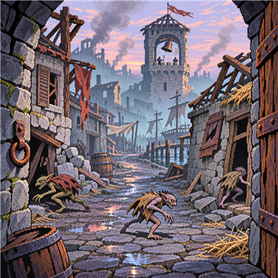
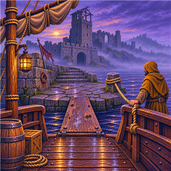
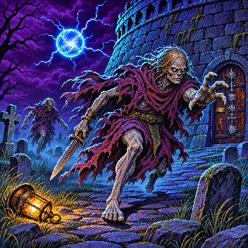
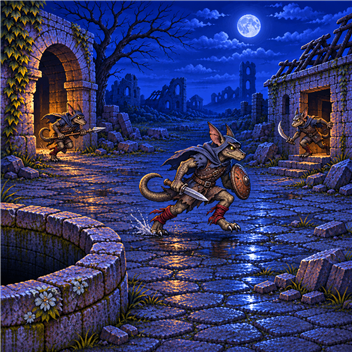
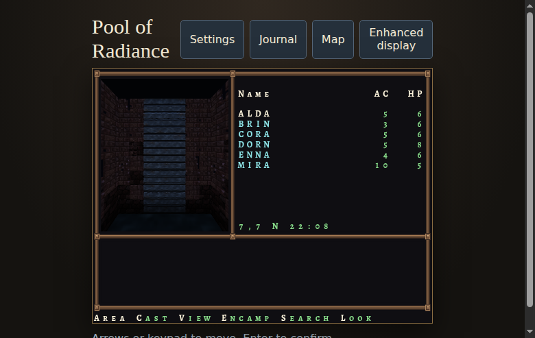
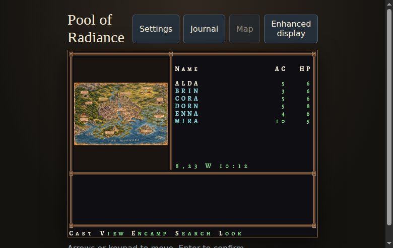

# Pool of Radiance


Phlan is a ruin on the Moonsea. Something ancient wears a dragon's body in Valjevo Castle. In 1988 you walked those streets in sixteen colors, 320 by 200, typing a word off a codewheel while the PC speaker buzzed the title theme.

This is that game. The same engine, ported line for line from `START.EXE` and `GAME.OVR`. And then it was rebuilt around you: every picture repainted, the explorer converted to a full 3D world, a narrator who speaks the lines, a journal of what the party has learned, maps you can travel, and an automapper that fills in only the ground you've walked. Every beep has been re-recorded. Every line of text is narrated.

## Every picture, repainted

The 1988 archives hold **4,526 frames** — every cell in the original picture files, including animation frames packed into those blocks. Enhanced paints **11,124 frames** across **9,504 subjects**: a subject is one portrait, sprite, or tile, with its pose and animation files counted together.

**16 colors → full color. 88×88 → 352×352. 8×8 tiles → 32×32. 24×24 combat sprites → 96×96.** Title cards go from 320×200 to 1,280×800. That's four times the pixels, and no 16-color ceiling.

The original portraits were 63 heads and 46 bodies, stamped together at 88×88. Enhanced has **842 portrait frames** across **560 faces and figures**. Scene pictures: **325** at 88×88, plus 21 ending frames, become **575** full-color 352×352 paintings. Combat: **218** pictures and **26** sprites, mostly 24×24, become **2,070 frames** across **1,059** sprites, nearly all a ready pose and a strike. Encounter sprites: **258** original frames become **413 frames** across **251** figures, near, middle, and far. The 8×8 floors and walls had **1,334** unique patterns; Enhanced has **6,548** painted 32×32 tiles.

<table>
  <tr>
    <td align="center" width="50%">
      <br>
      <em>Tyranthraxus, in the courtyard of Valjevo Castle</em>
    </td>
    <td align="center" width="50%">
      <br>
      <em>First meeting in the Kobold Caves</em>
    </td>
  </tr>
  <tr>
    <td align="center" width="50%">
      <br>
      <em>First arrival in the Slums</em>
    </td>
    <td align="center" width="50%">
      <br>
      <em>Ferry arrival at Sokal Keep</em>
    </td>
  </tr>
  <tr>
    <td align="center" width="50%">
      <br>
      <em>A wight in Valhingen Graveyard</em>
    </td>
    <td align="center" width="50%">
      <br>
      <em>Ambush at Kuto's Well</em>
    </td>
  </tr>
  <tr>
    <td align="center" width="50%">
      <br>
      <em>Bronze dragon, combat</em>
    </td>
    <td align="center" width="50%">
      <br>
      <em>Wyvern, mid-charge</em>
    </td>
  </tr>
</table>

The manifests also name overland tiles, battlefield cells, and character-sheet art. In all, `upgrades/` holds **14,076** PNGs: those 11,124 frames, 20 illustrated atlas plates, 78 code-wheel images, and supporting materials.

## A 3D world, not a flat window

The first-person explorer is a full 3D conversion. The original game still decides where the walls are — the same 16×16 grid, the same rules — but Enhanced builds a 3D world from that grid and the painted tiles: sun and sky outdoors, a warm light at the party under a roof, soft shadows, contact darkening, sky and height fog, a filmic finish and bloom, and reflections captured from the scene. You turn, and the light moves on the stone.

Story illustrations and combat keep their own presentation. The 3D view is the world you walk.

<table>
  <tr>
    <td align="center" width="55%">
      <br>
      <em>Kuto's Well, at night, in the game</em>
    </td>
    <td align="center" width="45%">
      <br>
      <em>The Temple of Tyr</em>
    </td>
  </tr>
</table>

## A narrator for the whole game

The 1988 release had no speech. A PC speaker, a Tandy chip, or silence. Twenty sound events, and that was the lot.

Enhanced has a narrator. **1,437 narration units** cover **1,688 of 2,025** script text events (the other 337 are interface and layout, and stay silent). Dynamic lines — a goblin patrol, a password, a vote at the Pool — are prerecorded in **70** families, **384** variant clips. **1,750** MP3s are attached to those units. The narrator performs the characters; the game's own text stays on screen as the only caption. Switch to Classic, and the voice stops.

The beeps are remade too: **11** new effects for the original combat and magic cues, plus a new title theme and battle sting.


## The Journal

Press **J**, or open **Journal**. The adventure journal is an Enhanced overlay: it lists what the party has discovered — commissions, proclamations, clues — and you can **Track** a lead to make it the current objective. Automatic tracking can be resumed after you pick one yourself. While the journal is open, the game waits.

It is saved in the same slot as the party. Load a game, and the journal comes back with it, in the browser or in the app.

## Fast travel across the Moonsea

In Enhanced overland play, the illustrated Moonsea plate *is* the travel map. It replaces the original overland view entirely. Destinations glow; click one, or focus it and press Enter, and the party walks there using the original game's own movement. Travel stops at encounters and story prompts. **Escape** cancels the route.

Select **Phlan** to choose a district — City Hall, the Training Hall, the Slums, Kuto's Well, and the rest — and the port picks the original road, gate, or ferry that actually gets you there. **Sokal Keep** goes through the harbor master; if he charges a fare, you pay it in the original menu, one platinum, one party member. Locked doors, combat, and decisions hand control back to you.

**Map** enlarges the illustration. The atlas also holds plates for the districts and dungeons, and it opens the one for where you are.




## The auto-mapper

Open **Map** and you get three views: **Local**, **Region**, and **Atlas**.

**Local** is the automap. It records each tile the party actually stands on, with the walls the original game drew there. It does not hand you the whole floor at the start of the game. Interiors and underground — Kuto's Catacombs, the Temple of Bane's inner halls — are remembered as their own floors. **Mark location** puts a label on the square you're in. A gold arrow is the party.

The map is stored in the save slot beside the journal, so a load restores it as it was. The runner keeps recording in Classic too; the illustrated atlas and the Local view are what you open in Enhanced.

## Play it anywhere — or exactly as it was

Play in the browser, or install the Electron app on macOS (Apple silicon and Intel), Windows, and Linux. No original files are required. The game starts in Enhanced.

Classic is the 1988 display: 320×200, 16-color EGA, the original menus, the original beeps. Point **File → Use Original Files…** (or **Settings → Use my original files** in the browser) at your own version 1.3 folder, or at the first release. The port does not copy those files. Press **F10**, or **Enhanced display**, to switch. Both modes share the running game and the same save slots.

Enhanced also puts the translation wheel on screen and requires the right word; Classic has no wheel and accepts any word, as the GOG program does.

## At a glance

Counts are measured from this tree. Classic frames are the `frames` totals in `game/pictures.json` (version 1.3). Enhanced frames are unique PNG files named by `upgrades/manifest.json` and `upgrades/slums/manifest.json`. A subject groups those files by pose and animation (ready/strike, near/middle/far, dialogue and phase frames). Narration counts come from `src/audio/voice-master-manifest.json`.

| | Classic (1988) | Enhanced |
| --- | --- | --- |
| Frames | 4,526 in the original picture archives | 11,124 painted frames, 9,504 subjects (14,318 bindings) |
| Portraits | 63 heads + 46 bodies, composed at 88×88 | 842 frames, 560 subjects, 352×352 |
| Scene pictures | 325 at 88×88, plus 21 ending frames | 575 paintings, 352×352 |
| Tiles | 1,334 unique 8×8 patterns (3,016 archive frames) | 6,548 tiles at 32×32 |
| Combat sprites | 218 pictures + 26 sprites, mostly 24×24 | 2,070 frames, 1,059 subjects, mostly 96×96 |
| Encounter sprites | 258 frames | 413 frames, 251 subjects, at 4× |
| Sound | 20 driver events, PC speaker and Tandy; no voice | 11 new effects, new scores, and 1,437 narration units covering 1,688 of 2,025 script lines |
| Explorer | 2D EGA framebuffer | 3D first-person world: lighting, shadows, fog, bloom, reflections |
| Journal, maps | Original menus | Journal with tracked objectives; Moonsea fast travel; Local automap, Region, and Atlas |
| Platforms | DOS | Browser, plus the app on Mac, Windows, and Linux |

## Play

Installers for macOS, Windows, and Linux need no checkout and no files from the player. See [docs/RELEASE.md](docs/RELEASE.md).

From a checkout, Node.js 22 or newer:

```bash
npm ci
npm run play
```

That serves the browser build at [http://127.0.0.1:43124](http://127.0.0.1:43124). The game runs in the page, its engine in a Web Worker, from `game/`. After updating the checkout, save through Encamp and restart `npm run play`; reloading the tab alone keeps the code the running server already loaded.

`npm run play:electron` opens the desktop window. `npm run play:loose` serves the loose files a packaged app carries. `npm run play:node` runs the older Node runner; unpacked original files in `gamedata/pool/` are used when present. Set `POR_GAMEDATA` to keep them elsewhere.

```bash
export POR_GAMEDATA=/path/to/pool
```

```powershell
$env:POR_GAMEDATA = 'C:\Games\pool'
```

**Classic files.** In the app, **File → Use Original Files…**; in the browser, **Settings → Use my original files**. The page looks for `START.EXE`, `GAME.OVR`, and `ECL1.DAX` in that folder or in one folder directly inside it (GOG keeps them in `POOLRAD`). Version 1.3 (`GAME.OVR` starts with `FBOV`) can run the game from those files; the first release (`TPOV`) unlocks Classic pictures while the game itself stays the version 1.3 data in `game/`.

**Encamp → Save** and **Load Saved Game** store the party, its journal, and its discovered map together. The browser and the app keep slots in IndexedDB. Import a folder of slot JSON files or a `roster.json` through **Settings → Saved games → Import save folder**.

In combat, **Home**, **Page Up**, **End**, and **Page Down** move or aim diagonally (keypad 7, 9, 1, and 3 as well). The game seeds its dice from the clock, as it did on DOS; `POR_CLOCK=fixed` starts the clock at noon, which is what the replays use.

## Tools and docs

```bash
npm run release:pack          # installers; see docs/RELEASE.md
npm run translate -- --output out/translated  # requires Python and capstone
npm run verify
npm run selftest
npm run tools -- list
npm run tools -- extract      # out/dax/<file>/<id>.bin
npm run tools -- images       # out/images/*.png  (original art, gitignored)
npx tsx tools/art-inventory.ts
npx tsx tools/export-dos-save.ts path/to/browser/saves J
```

`extract` and `images` write the original art into `out/`. Do not commit it.

- [docs/RENDERER.md](docs/RENDERER.md) — Enhanced 3D explorer
- [docs/AUDIO.md](docs/AUDIO.md) — original driver, Enhanced effects, narration
- [docs/MAP-CONCEPTS.md](docs/MAP-CONCEPTS.md) — atlas, travel map, and automap
- [docs/ART-INVENTORY.md](docs/ART-INVENTORY.md) — original DOS art inventory
- [docs/RELEASE.md](docs/RELEASE.md) — packaged apps
- [docs/CODE-WHEEL.md](docs/CODE-WHEEL.md), [docs/PORT.md](docs/PORT.md), [docs/COVERAGE.md](docs/COVERAGE.md)
- [docs/dax.md](docs/dax.md), [docs/ecl.md](docs/ecl.md), [docs/start-exe.md](docs/start-exe.md), [docs/game-ovr.md](docs/game-ovr.md)
- [docs/rea/NOTES.md](docs/rea/NOTES.md) — REA / Ghidra evidence

The opcode table and the wall-slot geometry were checked against Curse of the Azure Bonds, the next game on this engine, because that is the published reconstruction. coab has no license file; this tree does not copy it. Differences to expect on Pool of Radiance are listed in `docs/ecl.md`.
