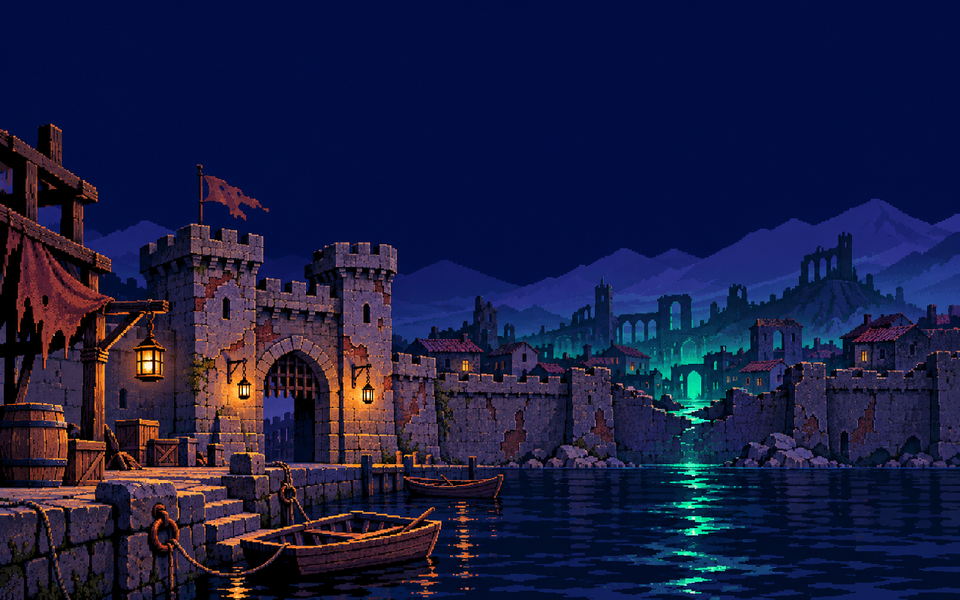
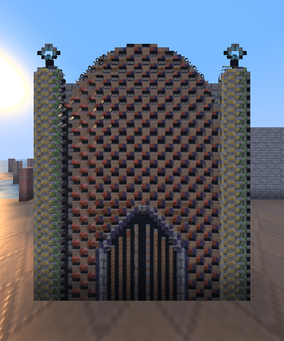

# Pool of Radiance

A browser and desktop port of SSI's 1988 Turbo Pascal game. Game procedures are
translated instruction by instruction from `START.EXE` and `GAME.OVR`. See
[docs/PORT.md](docs/PORT.md) and [docs/COVERAGE.md](docs/COVERAGE.md).

It ships ready to play in **Enhanced** display: new art, sound, narration, and a
WebGL explorer, running from the port's own data in `game/`. **Classic** display
is the original 320×200, 16-color EGA game, and it needs your own copy of the
DOS files (the one GOG sells is version 1.3; the first release also works). Both
modes share the same running game and the same save slots. Press **F10**, or
select **Enhanced display**, to switch when Classic is available.

The original files are optional and are never copied into the install. Without
them the game stays in Enhanced. Unpack a copy so `START.EXE`, `GAME.OVR`, and
the `*.DAX` files are in the same folder (GOG keeps them in `POOLRAD`).

## Classic and Enhanced

Numbers below are measured from this tree: Classic picture counts from
`game/pictures.json` and `game/tiles.json` (version 1.3), Enhanced art from
`upgrades/manifest.json` and `upgrades/slums/manifest.json`, sound from
`src/audio/original-sounds.json` and `src/audio/enhanced-sounds.json`, narration
from `src/audio/voice-master-manifest.json`, and the renderer from
[docs/RENDERER.md](docs/RENDERER.md). A binding is one manifest key; some
paintings are reused, so unique files are listed beside the key counts.
Enhanced replacement art is authored at 4× the original pixel size.

### Picture

| | Classic (1988 EGA) | Enhanced |
| --- | --- | --- |
| Display | 320×200, 16-color EGA palette | Full-color PNG at 4× the original pixels: title 1,280×800, portraits and scene pictures 352×352, tiles 32×32, combat sprites 96×96 |
| Title | 2 pictures at 320×200 (`TITLE.DAX`) | 4 title-card scenes at 1,280×800 (publisher, title, name, edition) |
| Portraits | 63 heads (88×40) and 46 bodies (88×48), composed to 88×88 | 1,499 bindings, 842 unique paintings, all 352×352 |
| Scene illustrations | 325 pictures at 88×88 (`PIC*.DAX`), plus 21 ending frames (`FINAL5.DAX`) | 1,161 bindings, 575 unique paintings, all 352×352 |
| Tiles | 1,334 unique 8×8 patterns (3,016 frames in `8X8D*.DAX`) | 7,926 bindings, 6,548 unique 32×32 tiles |
| Combat sprites | 218 combat pictures (`CPIC*.DAX`: 146 at 24×24, the rest 24×48, 48×24, or 48×48) and 26 `COMSPR.DAX` sprites at 24×24 | 2,377 bindings, 2,070 unique files, mostly 96×96, plus 38 effect bindings and 322 battlefield tiles at 32×32 |
| Encounter sprites | 258 `SPRIT*.DAX` frames at various sizes (16×49 to 48×80) | 594 bindings, 413 unique files, painted at 4× those sizes |
| Overland and atlas | Original 2D overland map | 248 overland tiles, 104 details, and 11 landmarks, all 96×96, plus 20 atlas plates at 1,536×1,024 in `upgrades/maps/` |

`upgrades/` holds 14,073 PNGs in all. The manifests name 11,121 of them; the rest
include 20 atlas plates, 78 code-wheel images, and supporting materials.

### Sound, music, and voice

The 1988 release has no AdLib, Sound Blaster, MIDI, sampled speech, or voice
data. Its driver lives in `START.EXE` and offers the PC speaker, the Tandy
chip, or silence.

| | Classic | Enhanced |
| --- | --- | --- |
| Sound events | 20 events in the original driver, rendered for both the PC speaker and the Tandy chip (40 MP3s in `audio/classic/`). Gameplay calls effects 2–12 and scores 13–14 (title theme and battle sting). Events 15–20 have no call sites. | 11 ElevenLabs replacements for effects 2–12, plus new title-theme and battle-sting scores (`audio/enhanced/`) |
| Voice and narration | None | 1,437 narration units covering 1,688 of 2,025 script text events (337 interface and layout events stay silent). 70 dynamic families add 384 variant clips. 1,750 MP3s are attached to those units (`audio/voices/`, ElevenLabs `eleven_v4`). Narration is Enhanced only; switching to Classic stops it. |

### Renderer, platforms, and saves

| | Classic | Enhanced |
| --- | --- | --- |
| Renderer | The original 2D EGA framebuffer. No WebGL. | WebGL exploration with normals, height and roughness derived from the painted atlas, sun and sky lighting, soft shadows, ambient occlusion, sky and height fog, a filmic tone map and bloom, and scene-captured reflections. Story illustrations and combat use their own presentation. |
| Journal, map, and wheel | The original menus. **J** stays with the game. No on-screen code wheel; any word is accepted, as in the GOG program. | Journal (**J**) with quest tracking, an illustrated atlas and area **Map** (landmarks on the Moonsea overland map can be selected as routes), and an on-screen translation wheel. See [docs/CODE-WHEEL.md](docs/CODE-WHEEL.md). |
| Platforms | DOS | The browser (`npm run play`), and an Electron app for macOS (Apple silicon and Intel), Windows, and Linux. See [docs/RELEASE.md](docs/RELEASE.md). |
| Saves | Same engine and the same slots in both modes. **Encamp → Save** and **Load Saved Game** store the party, its journal, and its discovered map together. The browser and the app keep slots in IndexedDB. `npm run play:node` stores them under `out/saves/`. A folder of slot JSON files or a `roster.json` can be brought in through **Settings → Saved games → Import save folder**. | Same. |

## The art

These are Enhanced paintings and captures from this repository. Classic art
stays in the player's own files and is not kept here.

The Enhanced title card, 1,280×800 (shown here at 960×600). The original title
is 320×200:



Portraits and scene illustrations are 352×352. The originals they replace are
88×88:

| Tyranthraxus in Valjevo Castle | First arrival in the Slums |
| --- | --- |
|  |  |

| Ferry arrival at Sokal Keep | Enhanced exploration, Temple of Tyr |
| --- | --- |
|  |  |

The illustrated Moonsea atlas in the Enhanced travel view:


## Play

Installers for macOS, Windows, and Linux need no checkout and no files from the
player. Packing them is described in [docs/RELEASE.md](docs/RELEASE.md).

From a checkout, use Node.js 22 or newer:

```bash
npm ci
npm run play
```

That serves the browser build at [http://127.0.0.1:43124](http://127.0.0.1:43124):
the game runs in the page, its engine in a Web Worker, from `game/`. After
updating the checkout, save through Encamp and restart `npm run play`; reloading
the tab alone keeps the code the running server already loaded.

`npm run play:electron` opens the same game in the desktop window. `npm run play:loose`
serves the loose files a packaged app carries (`npm run web:build-loose` writes
them to `out/loose/`). `npm run play:node` runs the older Node runner; unpacked
original files in `gamedata/pool/` are used when present (they win over `game/`).
Set `POR_GAMEDATA` to keep them elsewhere, `POR_GAME_SOURCE=port` to force the
port's own data, or `POR_GAME_SOURCE=original` to never fall back to it.

```bash
export POR_GAMEDATA=/path/to/pool
```

```powershell
$env:POR_GAMEDATA = 'C:\Games\pool'
```

### Classic files

In the desktop app, choose **File → Use Original Files…** and pick your version 1.3
install or the first release. In the browser build, use **Settings → Use my original files**.
The page looks for `START.EXE`, `GAME.OVR`, and `ECL1.DAX` in that folder or in
one folder directly inside it, and it does not copy them. Version 1.3 (`GAME.OVR`
starts with `FBOV`) can run the game from those files; the first release
(`TPOV`) unlocks Classic pictures while the game itself stays the version 1.3
data in `game/`. Saved games, artwork, narration, and the journal work on both
editions.

### Keys

In Enhanced display, press **J** or select **Journal** to see what the party
knows. Select **Track** next to a quest to make it the current objective.
**J** or **Escape** returns to play. Classic display leaves the original menus
and the **J** key to the game.

At start-up the version 1.3 game asks for a word from its translation wheel.
Enhanced display shows the wheel and requires the right word; **Escape** puts
the wheel away and brings it back. When the game later shows runes to translate,
the wheel comes up again by itself. Classic display has no wheel and accepts
any word, as the GOG program does.

Use **Map** to open the current area map. In Enhanced mode on the Moonsea
overland map, select an available landmark to follow its route. Select **Phlan**
to choose among available district approaches. Along the way, game prompts such
as ferry fares can require a party decision.

In combat, **Home**, **Page Up**, **End**, and **Page Down** move or aim
diagonally. The numeric keypad's 7, 9, 1, and 3 provide them, with Num Lock on
or off.

The game seeds its dice from the clock when it starts, as it did on DOS, so each
launch rolls differently. Set `POR_CLOCK=fixed` to start the clock at noon every
time; replays and checks use that so the same keys give the same results.

## Tools and docs

```bash
npm run release:pack          # installers; see docs/RELEASE.md
npm run translate -- --output out/translated  # requires Python and capstone
npm run verify                # translated routines, art assets, and audio
npm run verify:translation-reproducible
npm run selftest
npm run tools -- list
npm run tools -- extract      # out/dax/<file>/<id>.bin
npm run tools -- disasm       # out/ecl.txt
npm run tools -- images       # out/images/*.png  (original art, gitignored)
npx tsx tools/art-inventory.ts
npx tsx tools/export-dos-save.ts path/to/browser/saves J
```

`extract` and `images` write the original art into `out/`. That directory is
gitignored. Do not commit it. You can pass the game directory as the last
argument instead of `POR_GAMEDATA`.

- [docs/RENDERER.md](docs/RENDERER.md) — Enhanced WebGL look
- [docs/AUDIO.md](docs/AUDIO.md) — original driver, Enhanced effects, narration
- [docs/ART-INVENTORY.md](docs/ART-INVENTORY.md) — original DOS art inventory
- [docs/RELEASE.md](docs/RELEASE.md) — packaged apps
- [docs/dax.md](docs/dax.md), [docs/ecl.md](docs/ecl.md), [docs/start-exe.md](docs/start-exe.md), [docs/game-ovr.md](docs/game-ovr.md)
- [docs/MAP-GEOGRAPHY.md](docs/MAP-GEOGRAPHY.md) — illustrated-map geography
- [docs/rea/NOTES.md](docs/rea/NOTES.md) — REA / Ghidra evidence

The opcode table and the wall-slot geometry were checked against Curse of the
Azure Bonds, the next game on this engine, because that is the published
reconstruction. coab has no license file; this tree does not copy it.
Differences to expect on Pool of Radiance are listed in `docs/ecl.md`.

Native analysis uses [REA](https://github.com/morluto/rea) (`rea-agents` on npm)
with Ghidra 12.1.x and JDK 21. A packed `START.EXE` has to be unpacked before
REA will show the game rather than the EXEPACK stub. `GAME.OVR` is not an MZ;
slice it from the stub table the `exe` command prints, then inspect the slices.
