# Pool of Radiance

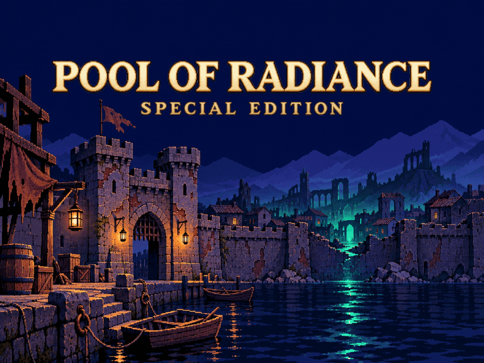

This is SSI's Pool of Radiance — the same adventure through the ruins of Phlan, the same party, the same fights, the same dragon under Valjevo Castle. What has changed is how it feels to be there.

Nothing about the gameplay has changed. Not one aspect of play differs from the original: the same rules, the same combat, the same encounters, the same story, the same difficulty. Everything is meant to feel original, and to be true to the original in every respect. The only things added are the artwork, the narration, and aids like the automap and the Journal — there to help you experience the original game as it was intended.

It is a full 3D conversion now. You walk the streets and dungeons in a world with sun, shadow, and torchlight, not a flat window of the 1988 display. A narrator voices the game from start to finish, reading the scenes and the dialogue as you play. And there is a boatload of new original artwork: every face, every street, every monster, painted over.

On top of that come the things the original never had. A Journal that remembers what the party has learned. Fast travel across an illustrated map of the Moonsea. An automap that fills in only the ground you have actually walked.

And here is the kicker. Once you have pointed the game at your own original files, you can hit **F10** at any moment and drop back into Classic — the 1988 game, exactly as it was — then hit **F10** again and return. Flip between them at will, the way *The Secret of Monkey Island: Special Edition* lets you. Same save, same party, same square. How to get those files is in [Playing Classic mode](#playing-classic-mode) below. Without them, the game stays in Enhanced, which is where it starts, and you do not need a single original file to play.

## Walking Phlan

Step off the ferry and Rolf is already on the dock, the city ahead of you under a clear sky. Walk the civic streets of New Phlan and the 3D world holds: sunlight on stone, vines on a wall, shadows that move when you turn. The game still decides where the walls are. What you see now is a place.

Story paintings and combat have their own presentation. The 3D view is the world you explore.

<table>
  <tr>
    <td align="center" width="50%">
      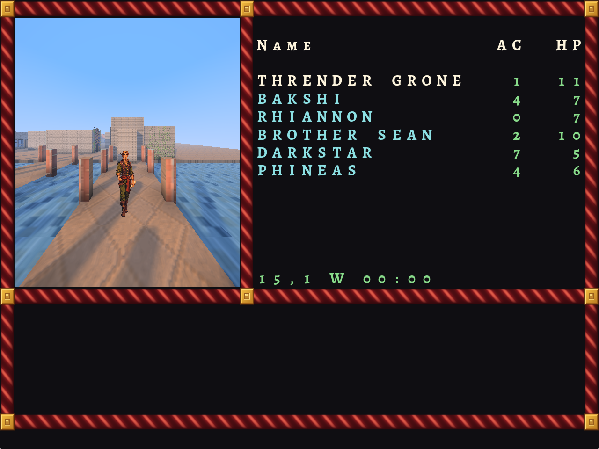<br>
      <em>Rolf on the dock at New Phlan</em>
    </td>
    <td align="center" width="50%">
      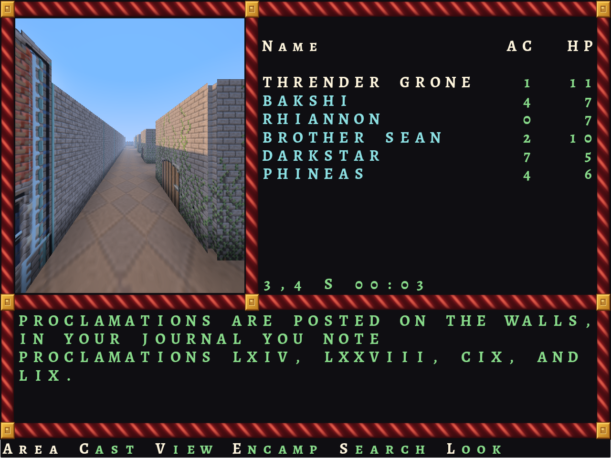<br>
      <em>A street in New Phlan</em>
    </td>
  </tr>
</table>

## A narrator, and a city that has been painted again

Walk into a tavern, or into the Council chamber, and a voice picks up the scene. The narrator reads the game as you go — the proclamations, the threats, the quiet lines in a crypt — and performs the characters while the original text stays on the screen. The old PC-speaker and Tandy beeps are still there if you want them. In Enhanced they have been remade, and the title theme and the battle sting with them. Switch to Classic, and the voice stops.

The pictures are new. Tyranthraxus is no longer a small composed portrait: he is a dragon in a ruined courtyard, coiled around the Pool. The first time you enter the Slums, kobolds scatter down a wet street under a ruined tower. A wight comes at you through the graveyard in a flash of lightning. Combat sprites strike and hold. None of this is a filter over the old art. It was painted for this game.

<table>
  <tr>
    <td align="center" width="50%">
      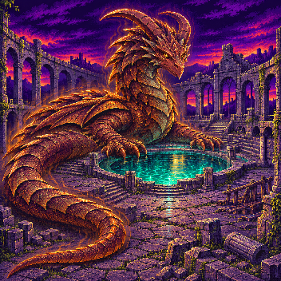<br>
      <em>Tyranthraxus, in the courtyard of Valjevo Castle</em>
    </td>
    <td align="center" width="50%">
      <br>
      <em>First meeting in the Kobold Caves</em>
    </td>
  </tr>
  <tr>
    <td align="center" width="50%">
      <br>
      <em>First arrival in the Slums</em>
    </td>
    <td align="center" width="50%">
      <br>
      <em>Ferry arrival at Sokal Keep</em>
    </td>
  </tr>
  <tr>
    <td align="center" width="50%">
      <br>
      <em>A wight in Valhingen Graveyard</em>
    </td>
    <td align="center" width="50%">
      <br>
      <em>Ambush at Kuto's Well</em>
    </td>
  </tr>
  <tr>
    <td align="center" width="50%">
      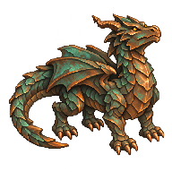<br>
      <em>Bronze dragon, combat</em>
    </td>
    <td align="center" width="50%">
      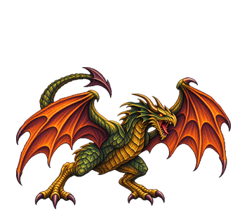<br>
      <em>Wyvern, mid-charge</em>
    </td>
  </tr>
</table>

<p align="center">
  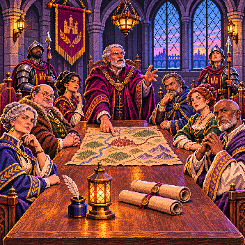<br>
  <em>The Council of New Phlan</em>
</p>

## The Journal, the map, and the road

Press **J** and the Journal opens on what the party has actually discovered: commissions, proclamations, clues. Track a lead and it becomes the current objective. The game waits while you read. Save the party, and the Journal is in the same slot.

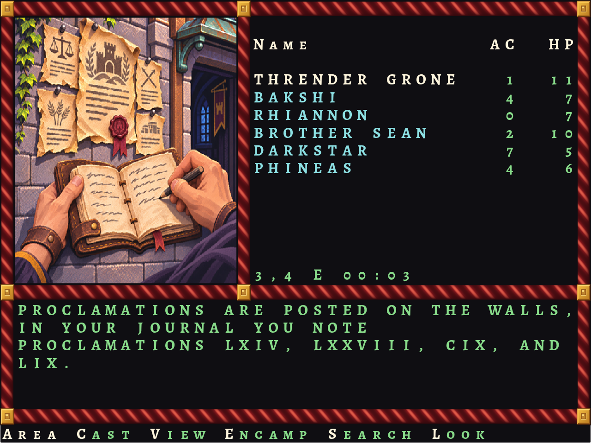

Open **Map** and you can leave the long walk behind. On the overland map, the illustrated Moonsea *is* the travel map. Destinations glow. Click one, or focus it and press Enter, and the party walks there using the original game's own movement. Travel stops at encounters and at story prompts; **Escape** cancels the route. Select **Phlan** to choose a district — City Hall, the Training Hall, the Slums, Kuto's Well — and the port takes the original road, gate, or ferry that actually gets you there. The boat to Sokal Keep still goes through the harbor master, and if he wants a fare, you pay it in the original menu.

The same **Map** has a Local view: an automap that records each tile you stand on. Solid walls and the doors you can walk through are drawn as the game itself understands them, and a marker shows where you crossed into another area or floor. Temples, shops, taverns, training halls and other named places, Journal clues, hazards and thefts are marked only after you have actually run into them. It does not hand you the whole floor at the start. Interiors and underground are remembered as their own floors. **Mark location** labels the square you are in. Load a save, and the map comes back as it was.

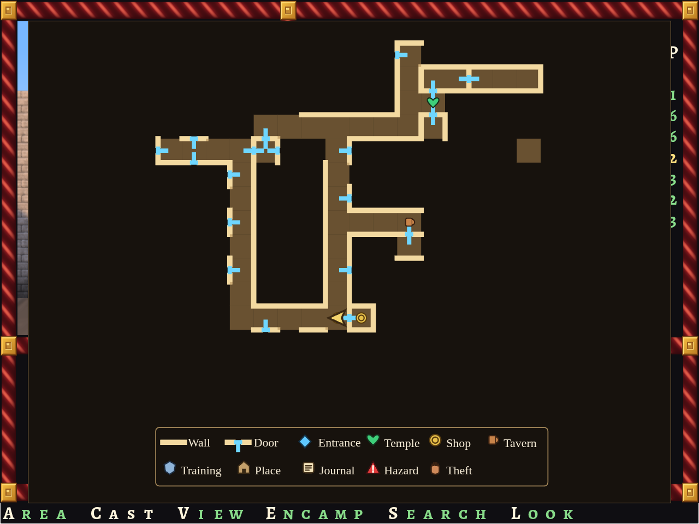

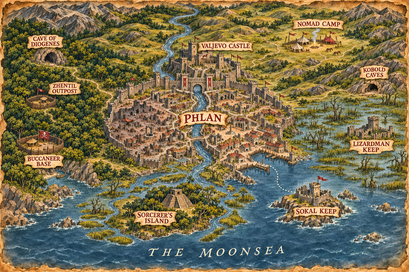

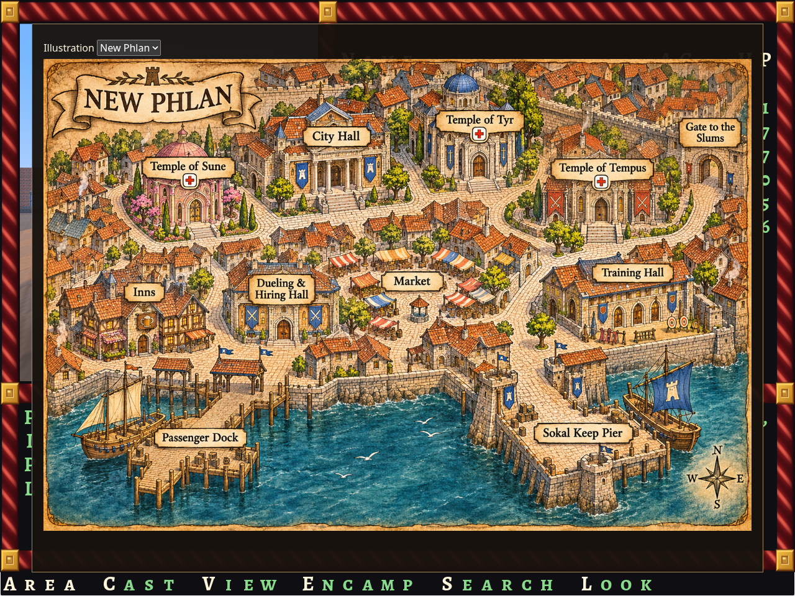

## One more thing

One more bonus, for anyone who remembers the cardboard wheel. The GOG release quietly dropped the copy protection: any word would do. We put the check back, and we built the translation wheel into the game — both discs, the runes, the paths — so in Enhanced you can match them and type the word the way it was originally meant to be done.

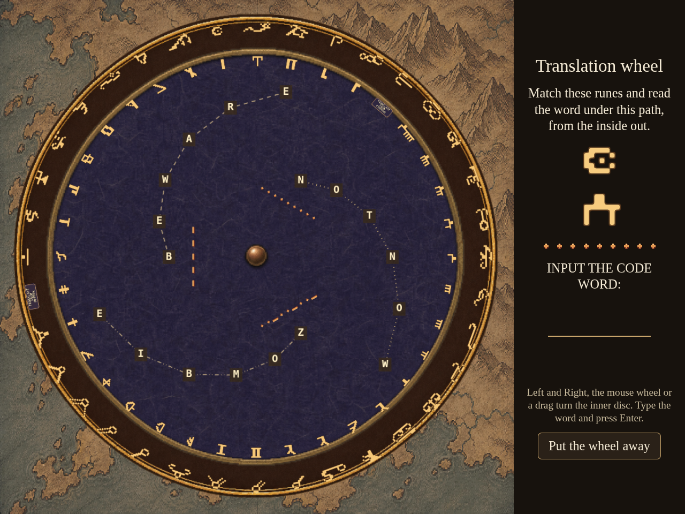

## By the numbers

Counts are measured from this tree. Classic frames are the `frames` totals in `game/pictures.json` (version 1.3). Enhanced frames are unique PNG files named by `upgrades/manifest.json` and `upgrades/slums/manifest.json`. A subject groups those files by pose and animation (ready/strike, near/middle/far, dialogue and phase frames). Narration counts come from `src/audio/voice-master-manifest.json`.

The 1988 archives hold **4,526 frames** — every cell in the original picture files, including animation frames packed into those blocks. Enhanced paints **11,124 frames** across **9,504 subjects**.

**16 colors → full color. 88×88 → 352×352. 8×8 tiles → 32×32. 24×24 combat sprites → 96×96.** Title cards go from 320×200 to 1,280×800.

| | Classic (1988) | Enhanced |
| --- | --- | --- |
| Frames | 4,526 in the original picture archives | 11,124 painted frames, 9,504 subjects (14,318 bindings) |
| Portraits | 63 heads + 46 bodies, composed at 88×88 | 842 frames, 560 subjects, 352×352 |
| Scene pictures | 325 at 88×88, plus 21 ending frames | 575 paintings, 352×352 |
| Tiles | 1,334 unique 8×8 patterns (3,016 archive frames) | 6,548 tiles at 32×32 |
| Combat sprites | 218 pictures + 26 sprites, mostly 24×24 | 2,070 frames, 1,059 subjects, mostly 96×96 |
| Encounter sprites | 258 frames | 413 frames, 251 subjects, at 4× |
| Sound | 20 driver events, PC speaker and Tandy; no voice | 11 new effects, new scores, and 1,437 narration units covering 1,688 of 2,025 script lines |
| Explorer | 2D EGA framebuffer | 3D first-person world: lighting, shadows, fog, bloom, reflections |
| Journal, maps | Original menus | Journal with tracked objectives; Moonsea fast travel; Local automap, Region, and Atlas |
| Platforms | DOS | Browser, plus the app on Mac, Windows, and Linux |

`upgrades/` holds **14,076** PNGs on disk: the 11,124 frames above, 20 illustrated atlas plates, 78 code-wheel images, and supporting materials.

The game procedures are translated instruction by instruction from `START.EXE` and `GAME.OVR`. See [docs/PORT.md](docs/PORT.md) and [docs/COVERAGE.md](docs/COVERAGE.md).

## Playing Classic mode

Classic is the original 1988 display, and this port does not ship the original pictures. You bring your own copy, then press **F10** (or **Enhanced display**) to flip between Classic and Enhanced. Both modes share the running game and the same save slots.

- **Version 1.3**, the edition this port targets, is sold on GOG as part of [Forgotten Realms: The Archives - Collection Two](https://www.gog.com/en/game/forgotten_realms_the_archives_collection_two), the Gold Box pack. It is not sold alone. After you install the collection, point the game at the `POOLRAD` folder inside it.
- **Version 1.1**, the first release, is in the [Strategic Simulations (SSI) PC Floppy Disk Image Collection](https://archive.org/details/20220918_20220918_1709) on the Internet Archive, as DOS disk images. Unpack a copy so `START.EXE`, `GAME.OVR`, and the `*.DAX` files are in the same folder. Classic will use those pictures; the game itself stays the version 1.3 data that ships with the port.

In the desktop app, choose **File → Use Original Files…** and pick that folder. In the browser build, use **Settings → Use my original files**. The page looks for `START.EXE`, `GAME.OVR`, and `ECL1.DAX` in the folder you choose, or in one folder directly inside it, and it does not copy them. Version 1.3 (`GAME.OVR` starts with `FBOV`) can run the game from those files; the first release (`TPOV`) unlocks Classic pictures only.

From a checkout, `npm run play:node` will use unpacked original files in `gamedata/pool/` when they are present. Set `POR_GAMEDATA` to keep them elsewhere:

```bash
export POR_GAMEDATA=/path/to/pool
```

```powershell
$env:POR_GAMEDATA = 'C:\Games\pool'
```

Enhanced shows the translation wheel on screen and requires the right word. Classic has no wheel and accepts any word, as the GOG program does.

## Play

The game starts in Enhanced and needs no original files. Installers for macOS, Windows, and Linux need no checkout either. See [docs/RELEASE.md](docs/RELEASE.md).

From a checkout, Node.js 22 or newer:

```bash
npm ci
npm run play
```

That serves the browser build at [http://127.0.0.1:43124](http://127.0.0.1:43124). The game runs in the page, its engine in a Web Worker, from `game/`. After updating the checkout, save through Encamp and restart `npm run play`; reloading the tab alone keeps the code the running server already loaded.

`npm run play:electron` opens the desktop window. `npm run play:loose` serves the loose files a packaged app carries.

**Encamp → Save** and **Load Saved Game** store the party, its journal, and its discovered map together. The browser and the app keep slots in IndexedDB. Import a folder of slot JSON files or a `roster.json` through **Settings → Saved games → Import save folder**.

In combat, **Home**, **Page Up**, **End**, and **Page Down** move or aim diagonally (keypad 7, 9, 1, and 3 as well). The game seeds its dice from the clock, as it did on DOS; `POR_CLOCK=fixed` starts the clock at noon, which is what the replays use.

## Tools and docs

```bash
npm run release:pack          # installers; see docs/RELEASE.md
npm run translate -- --output out/translated  # requires Python and capstone
npm run verify
npm run selftest
npm run tools -- list
npm run tools -- extract      # out/dax/<file>/<id>.bin
npm run tools -- images       # out/images/*.png  (original art, gitignored)
npx tsx tools/art-inventory.ts
npx tsx tools/export-dos-save.ts path/to/browser/saves J
```

`extract` and `images` write the original art into `out/`. Do not commit it.

- [docs/RENDERER.md](docs/RENDERER.md) — Enhanced 3D explorer
- [docs/AUDIO.md](docs/AUDIO.md) — original driver, Enhanced effects, narration
- [docs/MAP-CONCEPTS.md](docs/MAP-CONCEPTS.md) — atlas, travel map, and automap
- [docs/ART-INVENTORY.md](docs/ART-INVENTORY.md) — original DOS art inventory
- [docs/RELEASE.md](docs/RELEASE.md) — packaged apps
- [docs/CODE-WHEEL.md](docs/CODE-WHEEL.md), [docs/PORT.md](docs/PORT.md), [docs/COVERAGE.md](docs/COVERAGE.md)
- [docs/dax.md](docs/dax.md), [docs/ecl.md](docs/ecl.md), [docs/start-exe.md](docs/start-exe.md), [docs/game-ovr.md](docs/game-ovr.md)
- [docs/rea/NOTES.md](docs/rea/NOTES.md) — REA / Ghidra evidence

The opcode table and the wall-slot geometry were checked against Curse of the Azure Bonds, the next game on this engine, because that is the published reconstruction. coab has no license file; this tree does not copy it. Differences to expect on Pool of Radiance are listed in `docs/ecl.md`.
